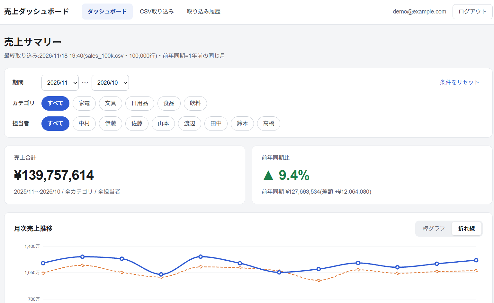

# 売上CSV集計ダッシュボード

売上CSVをアップロードすると、月次推移と商品別の売上を、期間・カテゴリ・担当者で絞り込んで確認できる社内向けのダッシュボードです。



## 1. プロジェクトの概要

- **目的**:手元のExcel・CSVで管理している売上を、上司がブラウザで見られる画面にし、担当者が毎月集計してファイルを送る手作業をなくす
- **想定ユーザー**:CSVを取り込む担当者と、数字を確認する上司(PC利用が中心、スマホでも崩れない)
- **主な機能**:
  - 売上CSVをアップロードし、Supabaseに保存する(同じ期間のデータは置き換え)
  - 取り込み前に、列・値・文字コードを検証し、内容をプレビューする
  - KPI(売上合計・前年同期比)、月次推移(棒グラフ⇄折れ線の切替、前年同月を重ねて表示)、商品別の売上と前年比を表示する
  - 期間・カテゴリ・担当者で絞り込む
  - メールアドレスとパスワードでログインする

### 開発のステップ

| Step | 内容 |
| --- | --- |
| 1 | 雛形作成、README・学習ノート |
| 2 | Supabaseのテーブル・インデックス・RLSの作成 |
| 3 | ログイン、ログアウト |
| 4 | 突合用の正解データを作るスクリプト |
| 5 | CSVアップロード(読み込み・文字コード判定・検証・プレビュー) |
| 6 | 取り込み(一括insert、置き換え、取り込み履歴) |
| 7 | 集計RPC、突合テスト |
| 8 | ダッシュボード画面(KPI・月次推移・商品別) |
| 9 | 絞り込み、棒グラフ⇄折れ線の切替 |
| 10 | 性能の計測と改善(10万行で5秒以内) |
| 11 | 検証、GitHub公開、Vercelデプロイ |

## 2. 使用技術

| 分類 | 技術 |
| --- | --- |
| フレームワーク | Next.js 16(App Router) |
| 言語 | TypeScript |
| スタイル | Tailwind CSS 4 |
| 外部サービス | Supabase(PostgreSQL・Auth) |
| グラフ | Recharts |
| テスト | Vitest |
| デプロイ | Vercel |

## 3. 全体のフロー

```text
CSVを選ぶ → ブラウザで検証・プレビュー → Supabaseに保存(取り込み中は集計に入れない) → 確定して旧データと置き換え → 集計RPC → ダッシュボード
```

取り込み中の行は「pending」の状態で保存し、全件そろってから旧データとの置き換えと有効化を1回の処理でまとめて行います。ダッシュボードには集計済みの数十行だけを返すため、10万行でも表示が重くなりません。

## 4. 学んだ事

{要約で3〜5点。詳細は [学習ノート](docs/learning-notes.md) を参照}

- {}
- {}

## 5. こだわった点

- **{こだわり1}**:{なぜそうしたか}
- **{こだわり2}**:{}

## 6. 改善点

- 閲覧するだけの人と、取り込みをする人の権限を分ける
- .xlsxをCSVに変換せず、そのまま取り込めるようにする
- 予算・目標値を登録し、達成率を表示する
- 月を選ぶと、日別の推移を表示する

## 7. 検証結果

達成基準3つは、すべて満たしました。

| 確認内容 | 環境 | 結果 |
| --- | --- | --- |
| 10万行のCSVで、取り込み完了から集計の表示まで5秒以内 | PC・本番モード(下記) | **1.07〜1.48秒**(3回とも達成) |
| 棒グラフと折れ線を切り替えられる | PC(Chrome) | 切り替えられ、リロード後も選んだ表示が残る |
| 集計の数字が原票CSVと1円単位で一致する(突合テスト) | Vitest | **44件すべて一致**(下記) |
| (目標)絞り込みの変更から表示まで1秒以内 | PC・本番モード | 0.57〜0.95秒(3回とも達成) |
| (参考)10万行の取り込み時間 | PC・本番モード | 5.60〜8.19秒 |

### 性能の計測方法

- 「取り込み完了から表示まで」は、取り込み完了画面の「ダッシュボードで確認する」を押してから、ダッシュボードの集計がすべて画面に出るまでの時間です。完了画面を見ている時間は含めません
- 「絞り込みの変更から表示まで」は、条件を変えてから、新しい集計が画面に出るまでの時間です
- 計測の表示は、開発中(`npm run dev`)か、環境変数 `NEXT_PUBLIC_SHOW_PERF=true` でビルドしたときだけ出ます
- 取り込みそのものの時間は、達成基準の対象外のため参考値です

| 項目 | 内容 |
| --- | --- |
| PC | AMD Ryzen 5 Microsoft Surface Edition・メモリ16GB・Windows 11 Pro |
| ブラウザ | Google Chrome 157 |
| 回線 | Wi-Fi |
| 起動方法 | `npm run build` → `npm start`(本番モード) |
| Supabase | Northeast Asia (Tokyo)・Freeプラン |

### 突合テストの内容

CSVをデータベースを通さずに直接読んで作った「正解データ」(`data/expected/`)と、集計RPCの結果を比べます。

| テスト | 件数 | 内容 |
| --- | --- | --- |
| `tests/aggregate.supabase.test.ts` | 8 | 本番のSupabaseに取り込んだ10万行に対し、8通りの絞り込み(すべて・全24か月・1か月・年をまたぐ2か月・カテゴリ・担当者・組み合わせ・該当なし)で比べる |
| `tests/aggregate.pglite.test.ts` | 24 | 手元のPGlite(PostgreSQL)で、サンプル → 置き換え → 履歴の削除と状態を変えながら、同じ8通りで比べる |
| `tests/params.test.ts` | 12 | 絞り込みのルール(URLの読み取り・チップの選び方) |

## セットアップ方法

```bash
git clone https://github.com/kasiyuha9528/csv-sales-dashboard.git
cd csv-sales-dashboard
npm install
```

`.env.local` を作成し、次の環境変数を設定します。

```text
{環境変数名}=
```

```bash
npm run dev
```

## ライセンス

[MIT](LICENSE)
